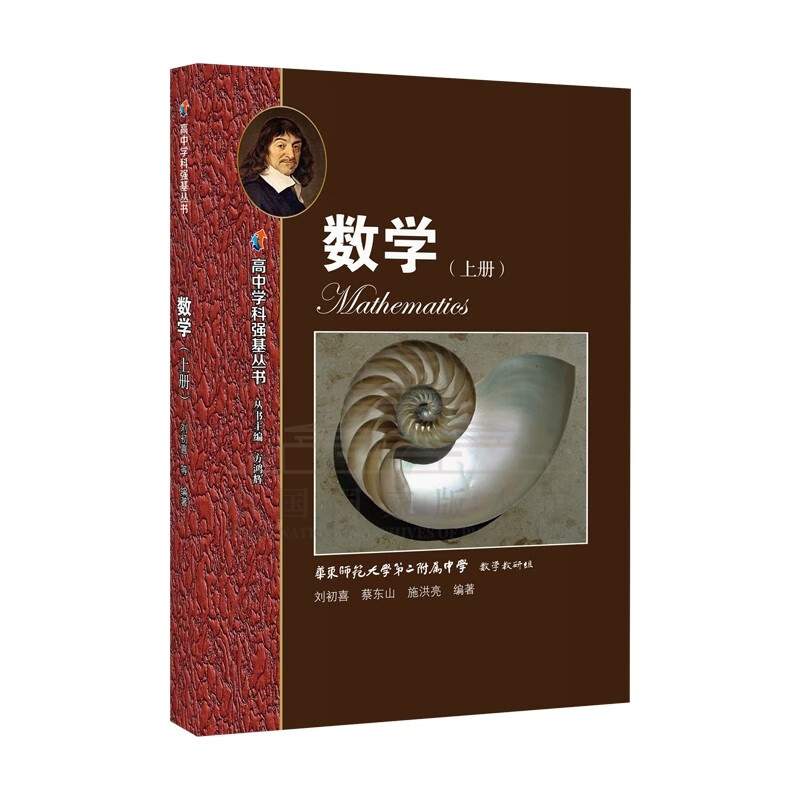
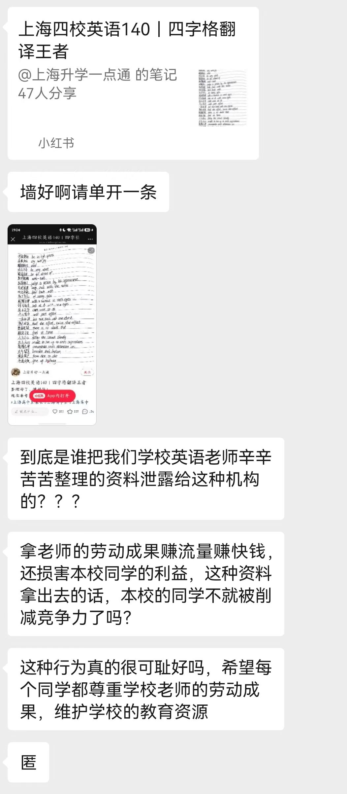
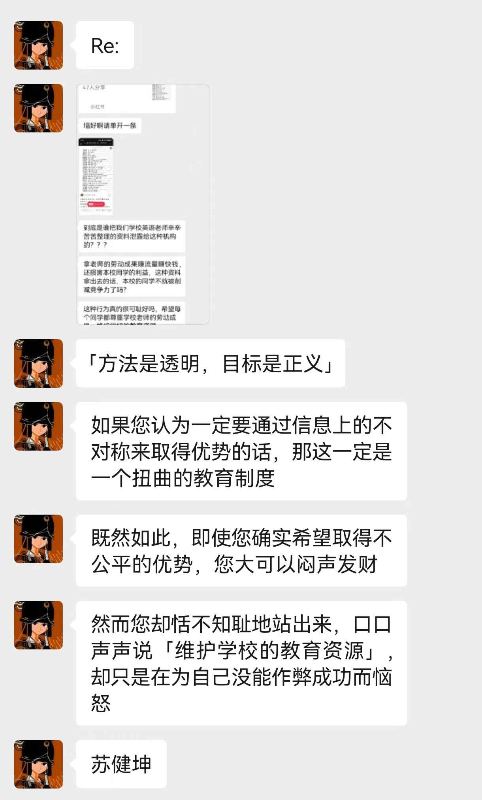
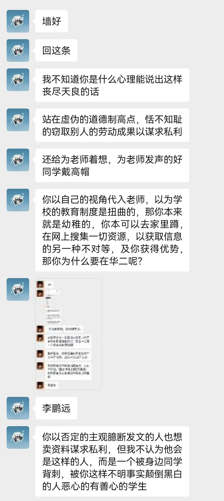
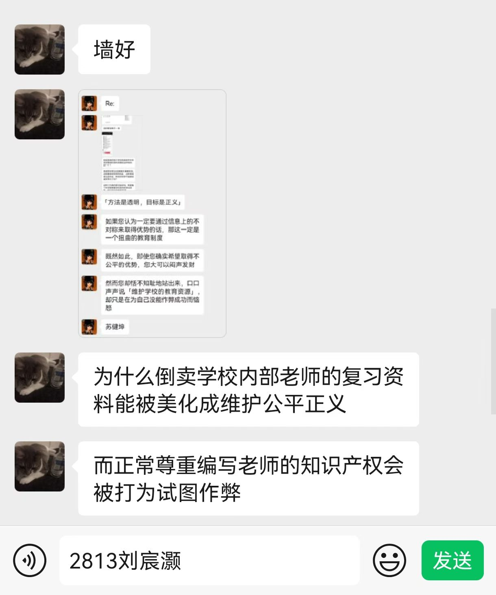
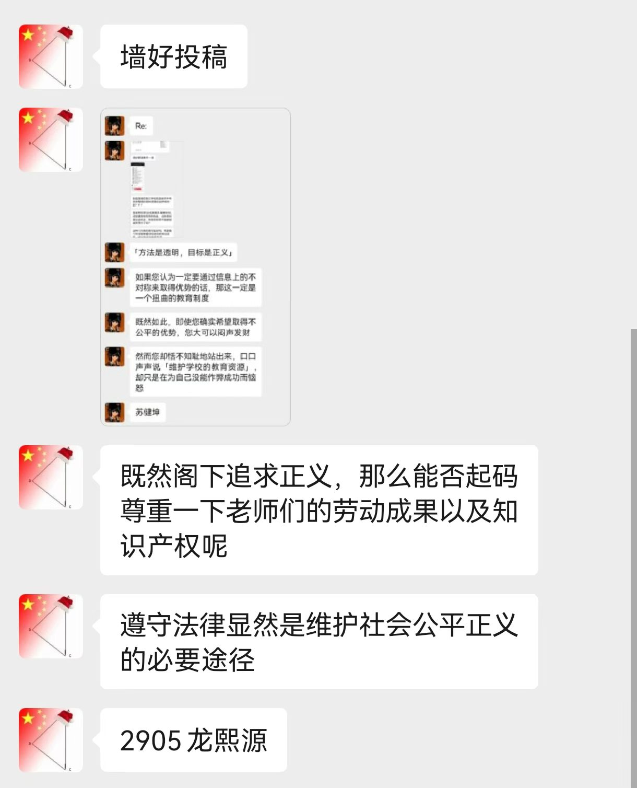

+++
title = "教育资源迷思"
published = 2026-10-27
description = ""
image = ""
tags = []
category = ""
draft = true
lang = ""
+++

# 教育资源迷思

## 前情提要

这件事起源于华师大二附中「墙」上的争论。2026-10-21 23\:08+08, 有人匿名发文称，在小红书上看到有转载了本校英语老师所整理的学习笔记。其提出二点指控：

- 这是对我校老师劳动的不尊重；以及

- 这泄漏了学校的教育资源，有损我校同学的竞争力。[^1]

我有强烈的不同意见，于 2026-10-21 18\:54+01 提交了回复，其在 2026-10-22 02\:14+01 公开发表。[^2]

这引起了巨大争议。2026-10-22 16\:19+08 起，校墙运营方以对公共资源的过度占用为由，拒绝接收后续有关投稿。

意识到讨论环境存在的客观限制，我在 2026-10-22 建立了邮件列表 [`efz-wall@groups.io`](mailto:efz-wall+subscribe@groups.io) . 其于 2026-10-22 11\:16+01 投稿至校墙，但因校墙运营延迟，到 2026-10-25 08\:15Z 才公开发表。

## 关于我的发言

我承认存在人身攻击。这对于理性的讨论并无贡献，有可能在激化意见矛盾，引起校墙运营方管制上有推动作用。我为我的过失致歉。

因为 [后见之明幻觉](https://www.readthesequences.com/Illusion-Of-Transparency-Why-No-One-Understands-You) 的困扰，且体裁本身的客观限制，我的发言在一些人中产生了歧义，在此澄清。时间所限，难以一一回答，我尽量保证回复了实名稿件。

- 我没有指控任何人，以字面意义上的方式，在任何考试或测试中作弊。我希望表达「作弊」的比喻义，即，通过利用不公开的信息（即所谓「教育资源」），在高考或其他竞争中获得 ***不公平的优势*** 。可能「开挂」是一个更好的比喻。[^msg-2]

- 我从未宣称当前的教育制度是扭曲的。「扭曲的教育制度」是「如果」句的 ***推论*** ，而不是一个无条件提出的观点。[^msg-1]

- 我并 ***不*** 认为华师大二附中掌握了任何不公开的资料，也 ***不*** 认为华师大二附中之所以成为全国范围内顶尖的中学，有赖于某些不公开的资料。[^msg-1]

- 我并 ***不*** 认为这位匿名同学在试图「倒卖资料」，却被抢了生意而恼火。我相信其在撰写投稿时也一定认为自己所行是正义之举。[^msg-1]

- 虽然我的确对公开资料者持正面态度，对现行的知识产权法律持负面态度，这不意味着我宣称其行为自动豁免于知识产权保护。我在撰写校墙投稿时，并不认为这是事情的重点，显然也没有为公开资料的行为作过任何辩护。[^msg-2][^msg-3]

我希望这充分回答了可能的疑惑和误解，并能使我们回到问题上来。

## 公平，公开

再次重申，我的观点是「好的教育制度是公开的」，而不是「现行的教育制度是不公开所以扭曲的」。我觉得从哲学高度上尝试证明这个观点有些无聊，而且关于这个问题的讨论已经由 **Julian Assange** 解释得很清楚了——顺带一提，他因为这个观点，被联合王国当局非法监禁了六年。

在此只列出几个显而易见的论据：

- 必须注意到教育的目的是 ***给人知识*** ，让你在高考中考的更好有可能是其副作用。

- 如果存在某些「秘籍」能够在教育上有显著的作用，很明显，将其公开是唯一对全人类的福祉负责的选项。

- 信息不是苹果：给出苹果就失去苹果，给出信息仍然有信息。公开信息不会让你直接失去任何东西。

- 因为一经泄漏就会很快传开，在一个学校内部秘传资料的决策，其可操作性与经济性看上去十分的可疑。

- 即使公开某些资料确实会让你失去对特定竞争对手的优势，获取这些优势本来就真的公平吗？

> The more secretive or unjust an organization is, the more leaks induce fear and paranoia in its leadership and planning coterie. This must result in minimization of efficient internal communications mechanisms (an increase in cognitive "secrecy tax") and consequent system-wide cognitive decline resulting in decreased ability to hold onto power as the environment demands adaption.
> 
> Hence in a world where leaking is easy, secretive or unjust systems are nonlinearly hit relative to open, just systems. Since unjust systems, by their nature induce opponents, and in many places barely have the upper hand, mass leaking leaves them exquisitely vulnerable to those who seek to replace them with more open forms of governance.
> 
> Only revealed injustice can be answered; for man to do anything intelligent he has to know what's actually going on.
> 
> — Julian Assange

## 什么是教育资源？

既然，如果我们在 ***应然*** 的世界上否定「教育资源是学校内部秘传的资料，而通过公开教育资源产生的资源泄漏，应当被认为不道德」这样的观点的话，一个自然的疑问就是，在 ***实然*** 的世界上的华师大二附中（此处可自由地替换为其他的中学和大学）是否 ***真的*** 有这样的内部资料。我们有义务去回答这个问题。

### 为什么华师大二附中没有葵花宝典

> **葵花宝典** 指我们正在尝试证伪存在的某些内部资料。一个「好」的学校通过掌握和秘传这些资料，建立起其竞争力。它们可以看成教育资源的一种。

首先，需要指出这个观点不一定能很好地推广。比如，特别是在工程学，很多知识本来就是私有的。虽然在大多数大学中，传授的内容差不了多少，但这些知识确实不对公众开放，更不用说工程领域中先进和军事化的技术。但是，对于华师大二附中这样一所只进行 ***通识*** 教育的 ***中学*** ，这是有效的。

在这个具体的争议事件中，涉及的英语学习笔记不是葵花宝典。ChatGPT 可以在几分钟内生成这些内容。我们并不否认或许有人为其付出了不少劳动，但它不是我们要找的东西——不足以提供任何值得一提的优势。

对于通识性质的教育而言，最好的资料肯定是公开的。这是一个相当成熟的领域，已经有大量的教育工作者积累了浩如烟海的著作。这些著作的总数远远超出任何一个学生学会知识所需要的千百倍，人们大都可以同意，找到资料并不是主要的工作，难的是挑选出合适的资料。那么，既然通识性质的教育不存在领域隔阂，一边是数十年来大量前人的遗产，在相对更充分的市场竞争下留下来的精华者，一边是学校内部一小群人闭门造车的产品，我们有没有合理的证据，来相信后面这一小群人中聚集了比其补集还要多的天才，或者后面这一所学校的体制比整个学术界合理得多，以至于可以在这样一个高度竞争的领域中领跑？

如此，我们可以得出结论：一所学校生产不出葵花宝典，哪怕是再优秀的学校也不行。（这并不是说学校里的人创作不了好的著作，只是这样的创作不可能在没有公开交流的情况下闭门造车地完成。）更进一步地，我们可以断言，不仅学校自己生产不了，同样也无法从别人取得，因为别人也没有这样的东西！在相当多的领域，特别是在学术界，「好」和「秘密」本来就是互相排斥的，而不是常见的 [认知偏差](https://www.lesswrong.com/posts/3diLhMELXxM8rFHJj/to-spread-science-keep-it-secret) 可能指示的那样。

如果局限于华师大二附中而言，还有一个极好的反例。

[ISBN `978-7-5720-1735-3`](https://pdc.capub.cn/search.html#/quick?type=%E5%9B%BE%E4%B9%A6&search=978-7-5720-1735-3)

上海教育出版社的这套书告诉我们，退一步说，如果一个这样的学校，认为自己发现了葵花宝典，人们接下来会做什么——这些资料会被印成铅字，面向公众出版。华师大二附中在这套教材上肯定有过不少投入，为什么没有把它藏起来？或许有一定的社会责任感，但这是想要成为一个好的学校，必须要有的正确认知：不要敝帚自珍。

### 你应该有教育资源吗？

TODO

### 教育资源是什么

TODO

## 正义的人与正义的雕像

TODO

[^1]:
    原始内容存档
    
    

[^2]:
    原始内容存档
    
    

[^msg-1]:
    原始内容存档
    
    

[^msg-2]:
    原始内容存档
    
    

[^msg-3]:
    原始内容存档
    
    
