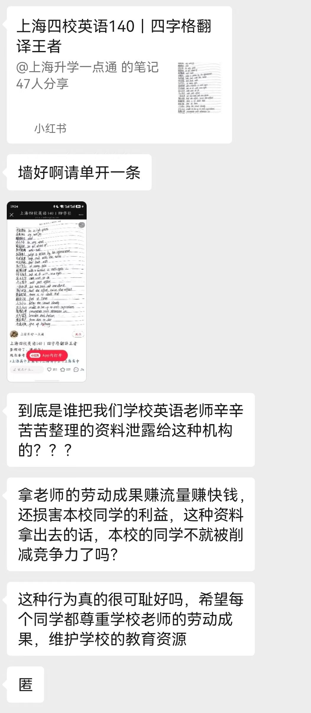
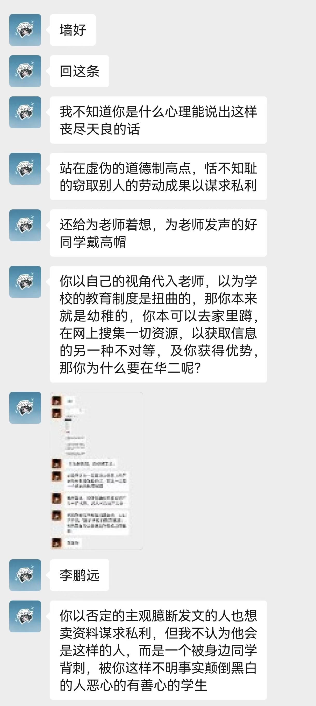
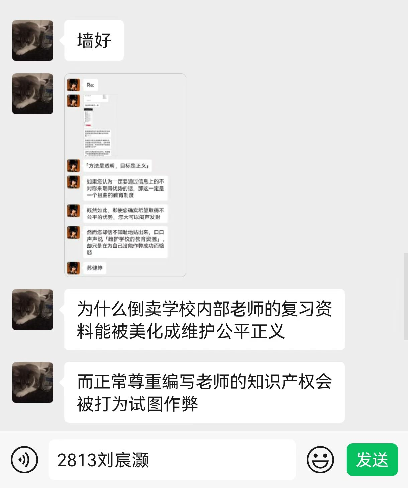
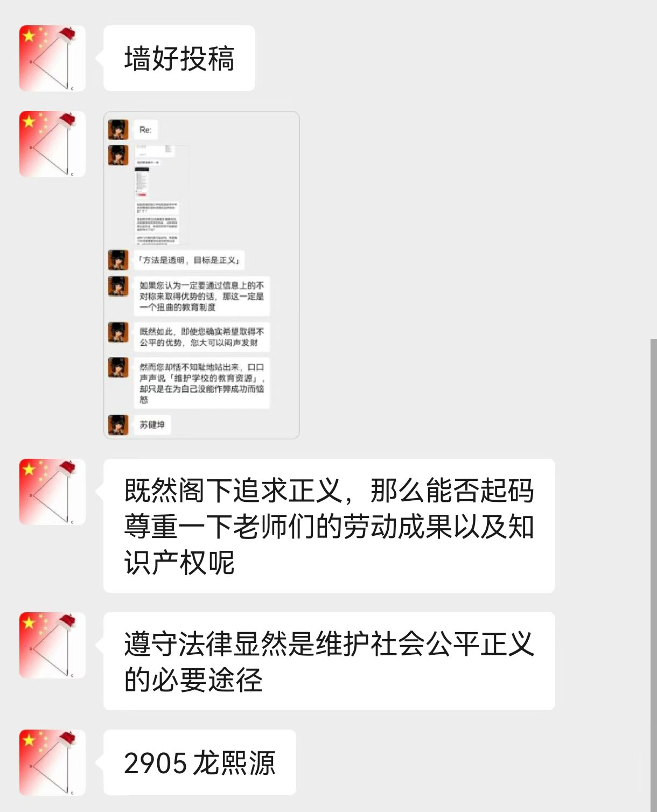

+++
title = "教育资源迷思"
published = 2026-10-27
description = ""
image = ""
tags = []
category = ""
draft = true
lang = ""
+++

# 教育资源迷思

## 前情提要

这件事起源于华师大二附中「墙」上的争论。2026-10-21 23\:08+08, 有人匿名发文称，在小红书上看到有转载了本校英语老师所整理的学习笔记。其提出二点指控：

- 这是对我校老师劳动的不尊重；以及

- 这泄漏了学校的教育资源，有损我校同学的竞争力。[^1]

我有强烈的不同意见，于 2026-10-21 18\:54+01 提交了回复，其在 2026-10-22 02\:14+01 公开发表。[^2]

这引起了巨大争议。2026-10-22 16\:19+08 起，校墙运营方以对公共资源的过度占用为由，拒绝接收后续有关投稿。

意识到讨论环境存在的客观限制，我在 2026-10-22 建立了邮件列表 [`efz-wall@groups.io`](mailto:efz-wall+subscribe@groups.io) . 其于 2026-10-22 11\:16+01 投稿至校墙，但因校墙运营延迟，到 2026-10-25 08\:15Z 才公开发表。

## 关于我的发言

我承认存在人身攻击。这对于理性的讨论并无贡献，有可能在激化意见矛盾，引起校墙运营方管制上有推动作用。我为我的过失致歉。

因为 [后见之明幻觉](https://www.readthesequences.com/Illusion-Of-Transparency-Why-No-One-Understands-You) 的错误，且体裁本身的客观限制，我的发言有歧义，并确实造成了误解。我有必要在此澄清。时间所限，难以一一回答，仅保证回复了实名稿件。

- 我没有指控任何人，以字面意义上的方式，在任何考试或测试中作弊。我希望表达「作弊」的比喻义，即，通过利用不公开的信息（即所谓「教育资源」），在高考或其他竞争中获得 ***不公平的优势*** 。可能「开挂」是一个更好的比喻。[^msg-2]

- 我从未宣称当前的教育制度是扭曲的。「扭曲的教育制度」是「如果」句的 ***推论*** ，而不是一个无条件提出的观点。[^msg-1]

- 我并 ***不*** 认为华师大二附中掌握了任何不公开的资料，也 ***不*** 认为华师大二附中之所以成为全国范围内顶尖的中学，有赖于某些不公开的资料。[^msg-1]

- 我并 ***不*** 认为这位匿名同学在试图「倒卖资料」，却被抢了生意而恼火。我相信其在撰写投稿时也一定认为自己所行是正义之举。[^msg-1]

- 虽然我的确对公开资料者持正面态度，对现行的知识产权法律持负面态度，这不意味着我宣称其行为自动豁免于知识产权保护。我在撰写校墙投稿时，并不认为这是事情的重点，显然也没有为公开资料的行为作过任何辩护。[^msg-2][^msg-3]

我希望这充分回答了可能的疑惑和误解，并能使我们回到问题上来。

## 公平，公开

再次重申，我的观点是「好的教育制度是公开的」，而不是「现行的教育制度是不公开所以扭曲的」。我觉得这不言自明。

- 必须注意到教育的目的是 ***给人知识*** ，让你在高考中考的更好有可能是其副作用。

- 如果存在某些「秘籍」能够在教育上有显著的作用，很显然将其公开是唯一对全人类的福祉负责的选项。

- 信息不是苹果：给出苹果就失去苹果，给出信息仍然有信息。公开信息不会让你直接失去任何东西。

- 因为一经泄漏就会很快传开，在一个学校内部秘传资料的决策，其可操作性与经济性是十分可疑的。

- 即使公开某些资料确实会让你失去对特定竞争对手的优势，获取这些优势本来就真的公平吗？

我想，从哲学高度的讨论的话，我们这个时代最伟大的英雄之一 Julian Assange 已经阐述得十分明白。他对正义的追求让他被联合王国当局非法监禁了六年之久。

> The more secretive or unjust an organization is, the more leaks induce fear and paranoia in its leadership and planning coterie. This must result in minimization of efficient internal communications mechanisms (an increase in cognitive "secrecy tax") and consequent system-wide cognitive decline resulting in decreased ability to hold onto power as the environment demands adaption.
> 
> Hence in a world where leaking is easy, secretive or unjust systems are nonlinearly hit relative to open, just systems. Since unjust systems, by their nature induce opponents, and in many places barely have the upper hand, mass leaking leaves them exquisitely vulnerable to those who seek to replace them with more open forms of governance.
> 
> Only revealed injustice can be answered; for man to do anything intelligent he has to know what's actually going on.
> 
> — Julian Assange

## 什么是教育资源？

TODO

## 正义的人与正义的雕像

TODO

[^1]:
    原始内容存档
    
    

[^2]:
    原始内容存档
    
    

[^msg-1]:
    原始内容存档
    
    

[^msg-2]:
    原始内容存档
    
    

[^msg-3]:
    原始内容存档
    
    
